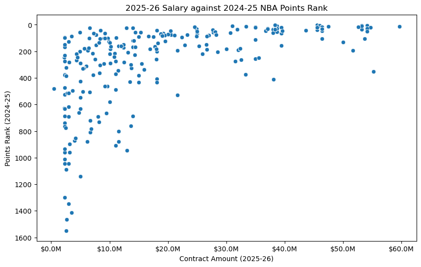
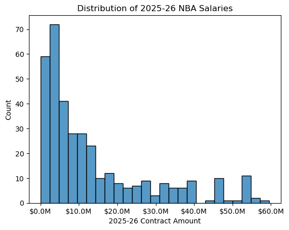

# NBA Player Performance vs. Pay

**Do the NBA's highest-paid players actually perform like it?** This project pulls player data from three different kinds of sources (a flat file, a website, and an API), cleans and standardizes each one, merges them in a SQLite database, and compares 2025-26 contract salaries against 2024-25 on-court performance.

---

## Key Findings

- **Salaries are heavily right-skewed.** Of the 450 players under contract for 2025-26, most earn under $20M, while a small group earns $40M–$60M.
- **High pay reliably signals elite scoring, but low pay doesn't signal poor scoring.** Nearly every player earning over ~$20M ranks among the league's top scorers. Below $20M, scoring rank ranges from elite to bottom of the league, which points to potential "bargain" contracts.
- **Points rank lines up with salary far better than win rank does.** Average salary by win rank was noisy, suggesting teams pay for individual production more than for winning-related stats.

*Each dot is a player. Above ~$20M (right side), players cluster near the top of the scoring ranks; below it, performance varies widely.*

## Data Sources

| Source type | Source | What it provides |
|-------------|--------|------------------|
| Flat file | [NBA Games dataset (Kaggle)](https://www.kaggle.com/datasets/nathanlauga/nba-games) | Game-by-game box scores per player |
| Website (scraped) | [Basketball-Reference contracts](https://www.basketball-reference.com/contracts/players.html) | Salaries by season, 2025-26 through 2030-31 |
| API | [nba_api](https://github.com/swar/nba_api) (official NBA stats endpoints) | 2024-25 season stats and league ranks |

## Approach

1. **Proposal:** Defined the question, sources, join strategy, and ethical considerations ([Milestone 1](milestone_1_proposal.pdf)).
2. **Flat file cleaning:** Standardized player names, filled and removed zero-minute games, mapped team abbreviations to full names, and dropped duplicates ([Milestone 2](milestone_2_flat_file.ipynb)).
3. **Web scraping:** Parsed the contracts table with `pandas.read_html`, removed repeated header rows, converted "$59,606,817"-style text to numbers, and calculated total and guaranteed contract value ([Milestone 3](milestone_3_web_scrape.ipynb)).
4. **API:** Switched from the balldontlie API to `nba_api` for richer data, then standardized names, percentages, and column labels ([Milestone 4](milestone_4_api.ipynb)).
5. **Merge & visualize:** Loaded all three datasets into SQLite, joined them on a standardized player-name key with SQL, and built six visualizations ([Milestone 5](milestone_5_merge_visualize.ipynb)).

**The biggest challenge** was matching players across sources: names appeared in different formats ("Nikola Jokić" vs. "Nikola Jokic"), team codes differed between sources (BKN vs. BRK), and the scraped table contained repeated header rows mid-table.

## Ethical Considerations

All data is publicly available, contains no personal information, and was used within each source's terms of use. The analysis avoids labeling individual players as "overpaid" or "not worth it," since salaries also reflect factors stats can't capture, such as leadership, marketability, and injury history.

## Next Steps

- Aggregate game-level data to one row per player before merging, so each player is weighted equally
- Use a numeric player ID instead of names as the join key to avoid mismatches
- Build a composite performance metric (points, rebounds, assists, efficiency) and model salary against it

## Tools

Python · pandas · NumPy · SQLite · SQL · nba_api · matplotlib · seaborn · Jupyter

---

*Completed August 2025 as a term project for DSC 540 (Data Preparation).*
